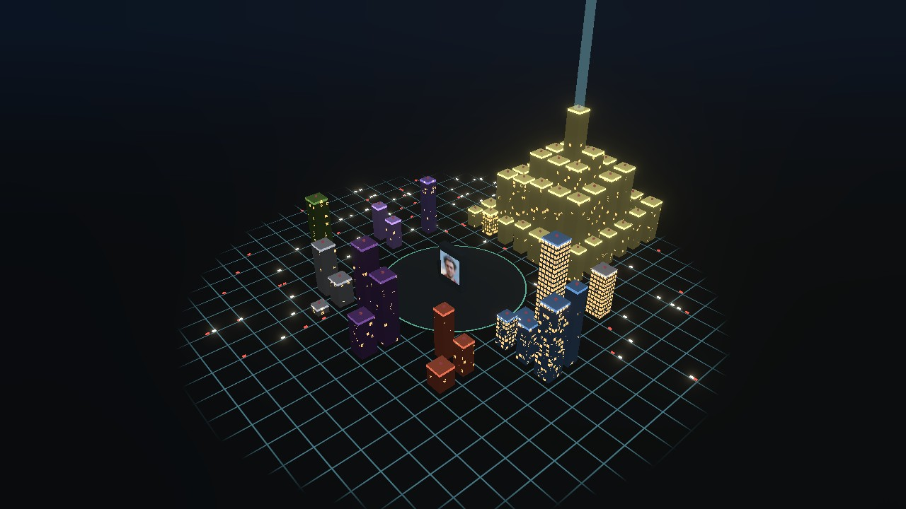
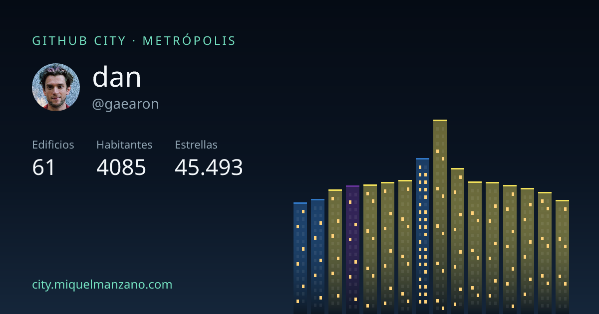
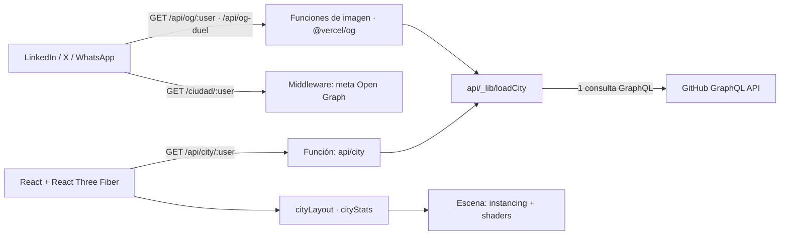

# GitHub City

[](https://github.com/Goti112/github-city/actions/workflows/ci.yml)
[](https://city.miquelmanzano.com)

**Convierte cualquier perfil de GitHub en una ciudad 3D que puedes recorrer.**
Cada repositorio es un edificio; los commits lo hacen crecer, la actividad reciente enciende sus ventanas y cada lenguaje forma su propio barrio.

👉 **[Prueba con tu usuario en city.miquelmanzano.com](https://city.miquelmanzano.com)**



## Qué hace

- **Vuelo de cámara cinematográfico** al entrar, mientras cae la noche sobre la ciudad.
- **Ciudad viva:** calles iluminadas, tráfico de luces, balizas en los tejados de los repos con estrellas y un edificio emblemático con haz de luz.
- **Tu ciudad en cifras:** de *Aldea* a *Metrópolis* según tus repos, con habitantes (commits), distritos, edificios encendidos, estrellas, tu rascacielos y tu barrio principal.
- **Explora:** gira, acerca y selecciona cualquier edificio: la cámara vuela hasta él y abre su repositorio. También puedes buscarlo por nombre o lenguaje (atajo `/`).
- **Historia:** un deslizador con reproducción automática reconstruye cómo se levantó la ciudad, año a año, desde tu primer repositorio.
- **Duelo de ciudades:** `/vs/usuario1/usuario2` enfrenta dos perfiles con un marcador por categorías y corona para el ganador.
- **Comparte:** cada ciudad y cada duelo tienen su propia tarjeta de vista previa para LinkedIn, X o WhatsApp, generada al vuelo. También puedes descargar una captura PNG.
- **Badge para tu README:** enseña tu ciudad en tu perfil de GitHub (botón 📛 en tu ciudad).
- Día, atardecer y noche; diseño adaptado a móvil; estados propios para usuarios inexistentes, perfiles vacíos y límites de GitHub.



## Pon tu ciudad en tu perfil

[](https://city.miquelmanzano.com/ciudad/Goti112)

Cambia `TU_USUARIO` y pégalo en el README de tu perfil:

```markdown
[](https://city.miquelmanzano.com/ciudad/TU_USUARIO)
```

## De datos a ciudad

| Dato de GitHub | En la ciudad |
| --- | --- |
| Commits de la rama principal | Altura: `1 + log2(commits + 1) × 1.5` (logarítmica, para que un repo enorme no aplaste al resto) |
| Estrellas | Tamaño de la parcela y baliza roja en el tejado |
| Lenguaje principal | Barrio y color de neón del edificio |
| Último push | Ventanas encendidas: todas si fue hace ≤ 30 días, casi ninguna pasado un año |
| Repo con más estrellas | Edificio emblemático con haz de luz |

Los barrios se empaquetan de forma voraz alrededor de una plaza central con tu avatar, del más grande al más pequeño, y las calles discurren entre parcelas.

## Arquitectura



- **Una sola consulta GraphQL** por perfil (perfil, 100 repos y calendario de contribuciones) desde una función serverless; el token nunca llega al navegador.
- **Caché en el edge:** `s-maxage=3600, stale-while-revalidate=86400`; un usuario inexistente se cachea 5 minutos y el resto de errores no se cachean. Las tarjetas de vista previa se cachean un día.
- **Vistas previas dinámicas:** los robots de las redes sociales no ejecutan JavaScript, así que un middleware sirve `/ciudad/:usuario` y `/vs/:a/:b` con sus propias etiquetas Open Graph, y `/api/og/:usuario` y `/api/og-duel` dibujan las tarjetas con `@vercel/og`.

## Decisiones técnicas

- **Lógica pura y testeada:** el transformador de GitHub, el layout, las cifras, el marcador del duelo, la línea temporal, el buscador, el encuadre y los movimientos de cámara, el tráfico y las etiquetas de compartir son funciones puras con tests. Los componentes interactivos (buscador, línea temporal, formulario de duelo) tienen tests con Testing Library. En total, 107 tests en Vitest.
- **Rendimiento:** todos los edificios se dibujan con un único `InstancedMesh`; ventanas, coronas de neón y calles se calculan en shaders, sin geometría extra. La escena 3D se carga bajo demanda: el bundle inicial pesa ~200 kB y Three.js llega aparte. Si el dispositivo no mantiene una tasa de fotogramas fluida, la resolución de renderizado baja automáticamente.
- **Cámara adaptativa:** el encuadre y la niebla se calculan a partir del tamaño de la ciudad, su edificio más alto y la proporción de la pantalla, así que una ciudad de 5 repos y una de 100 se ven enteras, también en vertical.
- **Accesibilidad:** los movimientos de cámara se omiten con `prefers-reduced-motion`; cualquier edificio es accesible sin ratón desde el buscador (combobox ARIA con flechas, Enter y Esc), y barra de herramientas, línea temporal y panel son controles HTML accesibles con teclado.
- **Robustez:** reintentos ante errores transitorios de GitHub, detección del rate limit de GraphQL (que llega como HTTP 200) y `api/` comprobado con la resolución de módulos de Node ESM para que los fallos de importación salgan en CI y no en producción.

## Stack

React 18 · TypeScript · Vite · React Three Fiber · Drei · postprocessing · React Router · Vercel Functions y Routing Middleware · `@vercel/og` · GitHub GraphQL API · Vitest · Testing Library · Oxlint · GitHub Actions

## Ejecutar en local

```bash
npm install
cp .env.example .env   # añade GITHUB_TOKEN=... (token de GitHub con lectura de repos públicos)
npm start              # vercel dev: front + funciones + middleware en http://localhost:3000
```

`npm run dev` levanta solo Vite, sin las funciones serverless.

```bash
npm run lint   # oxlint + comprobación de tipos de api/ y middleware
npm test
npm run build
```

---

Hecho por [Miquel Manzano](https://miquelmanzano.com).
