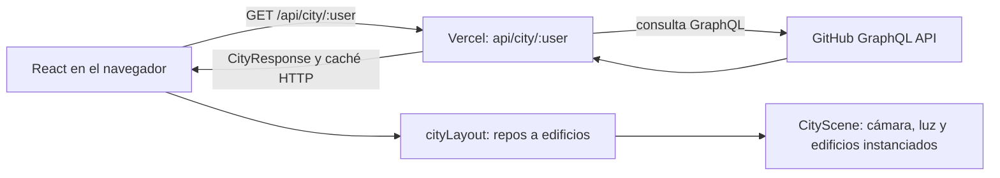

# GitHub City

Convierte los repositorios públicos de cualquier perfil de GitHub en una ciudad 3D. La altura de cada edificio representa su actividad de desarrollo; sus ventanas muestran si el repositorio sigue activo.


**Demo prevista:** [city.miquelmanzano.com](https://city.miquelmanzano.com) — pendiente de publicación.

La imagen de cabecera es una ilustración genérica para compartir el proyecto. La captura real de una ciudad se descarga desde la barra de herramientas de la aplicación.

## Funciones

- Busca perfiles públicos o abre una de las ciudades de ejemplo.
- Gira y acerca la ciudad; selecciona un edificio para abrir los datos de su repositorio.
- Cambia entre día y noche, descarga una captura PNG con marca de agua y copia el enlace de la ciudad.
- Muestra estados para la carga, usuarios inexistentes, perfiles sin repositorios, límites de GitHub y errores de red.
- Adapta el panel del repositorio a un panel inferior en pantallas pequeñas.

## Stack

- React, TypeScript y Vite.
- React Three Fiber, Three.js y Drei para la escena 3D; postprocesado con Bloom.
- React Router para las rutas `/` y `/ciudad/:user`.
- Función serverless de Vercel y API GraphQL de GitHub.
- Vitest para la lógica pura y Oxlint para lint.

## Arquitectura



La función valida el nombre de usuario, consulta los repositorios públicos propios y transforma la respuesta en `CityResponse`. Las respuestas correctas usan `s-maxage=3600, stale-while-revalidate=86400`; los errores no se guardan en caché.

## Decisiones técnicas

- `cityLayout` y el transformador de GitHub son funciones puras: mapean datos a edificios sin modificar su entrada. La suite cubre altura logarítmica, tamaño de parcelas, antigüedad, agrupación por lenguaje y solapamientos.
- La altura crece con `1 + log2(commits + 1) * 1.5`; las estrellas determinan el tamaño de la parcela y la fecha del último push controla la luz de las ventanas.
- Los repositorios se dibujan con `InstancedMesh` para reducir llamadas de dibujo. Las ventanas se calculan en el shader, sin añadir geometría por ventana.
- La escena admite hasta 100 repositorios públicos propios por consulta. Los forks se excluyen; los repositorios archivados se conservan y se atenúan según su actividad.
- El token `GITHUB_TOKEN` solo se usa en el servidor. Nunca se envía al navegador ni se guarda en Git.
- La API distingue nombres inválidos, usuarios inexistentes, rate limits y errores de GitHub/red. Las respuestas correctas se cachean durante una hora y pueden servirse durante un día mientras se actualizan.

## Ejecutar en local

Necesitas Node.js y npm. Para que la función `/api/city/:user` esté disponible, ejecuta el proyecto con Vercel CLI.

1. Instala las dependencias:

   ```bash
   npm install
   ```

2. Copia `.env.example` a `.env` y añade un token de GitHub con lectura de repositorios públicos. En PowerShell:

   ```powershell
   Copy-Item .env.example .env
   ```

   Añade `GITHUB_TOKEN=...` a `.env`. El archivo está ignorado por Git; no compartas el token ni lo incluyas en el frontend.

3. Inicia Vercel Dev:

   ```bash
   npm run start
   ```

   Abre la dirección local que muestre Vercel. La primera ejecución puede pedir iniciar sesión y vincular el proyecto en Vercel.

`npm run dev` inicia solo Vite; para probar la API serverless local, usa `npm run start`.

## Comprobaciones

```bash
npm test
npm run lint
npm run build
```

La revisión visual en escritorio y móvil, el rendimiento real con unos 100 repositorios y la comprobación del PNG descargado se hacen en el navegador.

## Publicación

La demo y el dominio están pendientes de los pasos manuales del proyecto: subir el repositorio público a GitHub, importarlo en Vercel, configurar `GITHUB_TOKEN`, desplegar y añadir el dominio con el CNAME indicado por Vercel.
